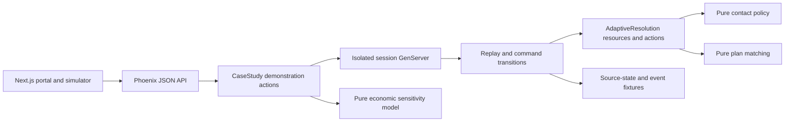

# Architecture

`Session.open("S04", "treatment")` returns an isolated session and a complete view. `Session.act(id, command_id, command)` changes that session and returns its new view. The portal and operator views share the session ID. `Policy.evaluate(account, events, intent, contacts, history, now, settings)` is pure. `Portal.match(options, preferences, now)` only matches existing fixture terms.

Two clocks are separate. Source patches apply at their effective time; notifications are visible at ingestion time. Replay advances chronologically through source changes, event arrivals and queued handoffs. Event occurrence governs recency. Notifications never overwrite authority. A handoff re-reads the source state and checks the shared contact budget inside the session's serial operation. No future source patch is exposed to the policy function.

The `AdaptiveResolution` Ash domain exposes typed `JourneyDecision` and `ApprovedPlanOption` resources. Their create actions run custom changes that invoke the pure decision and matching functions. Always-on domain authorization requires the local simulated role. `CaseStudy` holds the demonstration/session transport operations. These authorization policies demonstrate the framework boundary; they are not production authentication.

A queued proposal is distinct from applying it or handing it to a simulated provider. Replacing a contact preserves its stable ID; cancellation and replacement are one state change. Handoffs count even on simulated delivery failure. A proposal cannot be recalled after handoff. Command IDs reject conflicting reuse and prevent duplicate effects. Session state is ephemeral and isolated per demonstration; restart clears it.

## Design comparison

The architect workflow explored two isolated sketches. Both kept policy pure. Candidate A uses per-session GenServers; B replays a versioned command journal through ETS compare-and-swap. We selected the session design: standard OTP serialisation is easier to verify than a custom CAS retry protocol in this timebox. From B we kept occurrence-based recency, immutable handoff records and explicit command receipts. Full event-sourcing and a database were rejected as unnecessary for this local demonstration.

The accepted limitation is restart data loss in exchange for zero database or queue setup. Production delivery guarantees and authentication require separate integration work.
