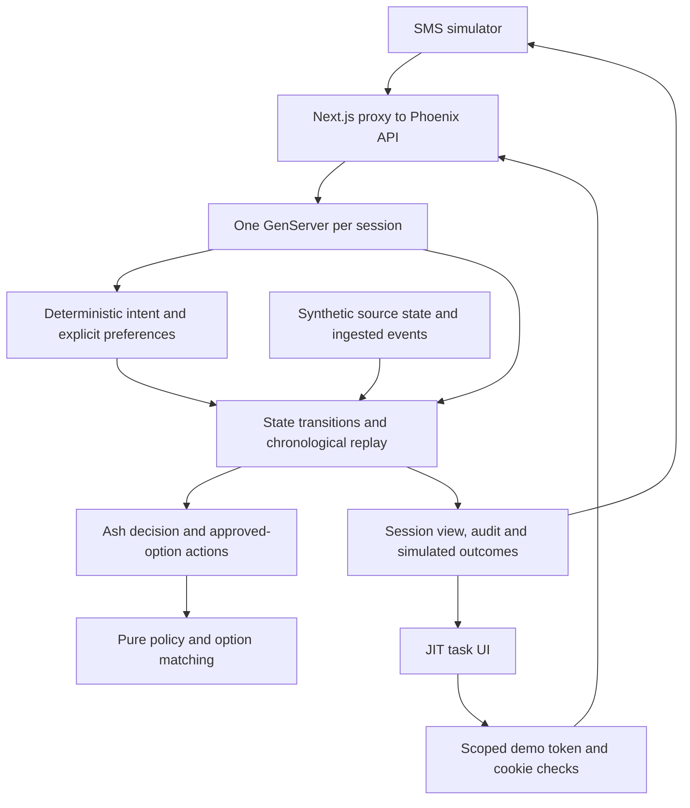

# Architecture

V2 adds conversation and focused tasks to the existing Next.js and Elixir/Ash demonstration. The backend owns product decisions; the frontend presents them. Everything runs locally without a database, provider or consumer-facing model. The [README](../README.md) explains the product; the [HTTP/data contract](integration-contract.md) defines commands and views.

## Responsibilities

| Component | Owns | Reason for the boundary |
| --- | --- | --- |
| `apps/web` | SMS/JIT presentation, local operator controls, typed API adapter and financial UI | One shared session keeps conversation and consumer outcomes coherent. Product rules stay on the server. |
| Phoenix controller and routes | JSON transport, errors, demo-cookie exchange | Operator and scoped consumer requests have different access rules. |
| `Session` and `JitAuth` | Serial session access, command receipts, link hashes, grants and purpose allowlists | Duplicate requests cannot repeat effects; one task cannot use another task's authority. |
| `Conversation` | Bounded deterministic intent rules, stated preferences, fixed responses and task descriptors | A classifier can propose an action without gaining authority to alter terms or make commitments. |
| `Replay` | Account/event clocks, transitions, drafts, contact coordination and audit | Current source state can differ from the latest received event. |
| `AdaptiveResolution` Ash domain | Typed `JourneyDecision` and `ApprovedPlanOption` actions calling pure rules | Eligibility and unchanged approved-option matching remain explicit backend decisions. |
| `Economics` and separate conversational calculator | Original reach/lift arithmetic and V2 responder sensitivity | Different denominators and costs remain visible; Python companions reproduce the cases. |

The `CaseStudy` Ash domain groups demonstration transport and economics actions. Internal Ash authorisation requires simulated journey/portal roles. This is separate from consumer JIT authentication. See the [backend guide](../apps/api/README.md) for resource/action detail and the [frontend guide](../apps/web/README.md) for presentation ownership.

## State, time and contact authority

Each scenario opens an isolated GenServer. Commands include an opaque ID: a matching retry returns the recorded result, while conflicting reuse is rejected. Sessions are bounded, expire after 30 idle minutes and disappear on restart. OTP serialisation gives a small, understandable implementation; it does not provide durable storage, distributed processing or production delivery guarantees.

Source patches apply at their effective timestamp. Notifications become visible only after ingestion; occurrence time governs recency. Advancing the fixture clock visits source changes, notifications and queued handoffs in order. The decision cannot see future patches. S05 and S06 demonstrate a changed source permission/payment state before its delayed notification arrives.

A contact proposal, a queued replacement and a provider handoff are separate states. Scheduling preserves the queued contact ID and its original baseline. Handoff rereads current source state, local window and the shared cross-channel budget. Unknown required state, opt-out, holds, pending payment or an active plan block inappropriate outreach. Failed delivery still counts after handoff; exact rolling-window boundaries count too.

## Conversation and consumer action

Incoming text produces an intent, explicit preference updates and an evaluated response/task. Views distinguish baseline previews, proposed replies, simulated responses and suppression. Replies do not create proactive contacts, reset budgets or restore permission. Requested service replies are a separate action class; the demo still checks scope, language and current SMS permission, with a single STOP acknowledgement exception. Production classification and content need human compliance review.

Hardship, dispute and reported-payment routes latch an escalation, pause collection prompts and plan mutations, and offer assistance. The classifier cannot add a formal account hold. An explicit operator control simulates human/account-service updates. Clearing a conversation review flag never releases an authoritative hold.

A draft stores a matching option's exact terms and the stated preferences without creating an agreement. Resume checks expiry, account eligibility, option availability, matching and unchanged terms. A historic plan-start event cannot supply saved fields. Review and explicit consumer confirmation are still required; a current review token protects against stale terms. Payment controls create only synthetic pending state.

## JIT access and its limits

The operator issues a random opaque token for one account/action; the server keeps its SHA-256 hash. Verification consumes the token and returns a scoped grant in an HTTP-only, SameSite Strict cookie. The task allowlist and fresh domain checks apply to subsequent commands. Raw tokens are excluded from session views/audits and filtered from controller parameter logging.

| Lifetime | Clock | Consequence |
| --- | --- | --- |
| Link: 120 seconds, single use | Real server time | Expiry, reuse or wrong account/action is rejected. |
| Scoped grant: 600 seconds | Real server time | The task needs fresh verification after expiry. |
| Draft: 24 hours at most | Synthetic scenario time | Resume revalidates or returns a recovery state. |
| Session: 30 idle minutes, or API restart | Server process lifetime | Conversation, draft, links and grants are lost. |

The identity checkbox is a simulation. Phone-link possession is not proof of identity. Local cookies omit Secure for HTTP; production needs HTTPS and a reviewed identity/session design. The operator `/sessions` endpoints intentionally expose full synthetic state without authentication. JIT account details are gated inside the task, but this app is not a production data-security boundary and must not be exposed as a customer service.

## Implemented, simulated and deferred

Intent rules, session memory, policy decisions, task descriptors, draft revalidation, scoped access checks, approved-option matching and explicit outcome transitions are implemented. Provider delivery, identity proof, authoritative source services, support operations and money movement are simulated. The [commercial guide](commercial/README.md) describes calculations as sensitivity, not observed ROI.

Durable conversation storage, privacy/retention, inbound SMS infrastructure, operational ownership, abuse controls, production analytics and US content approval remain dependencies. A live LLM was deferred to keep the demonstration reproducible without keys or network calls. The proposed pilot should reuse existing authentication and add minimal resume only if week-one feasibility and security review support it. [Assumptions](assumptions.md) records validation priorities; [product philosophy](product-philosophy.md) explains the consumer and autonomy choices.
