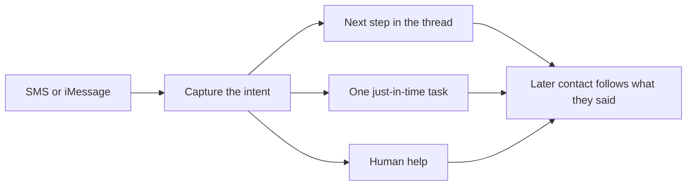
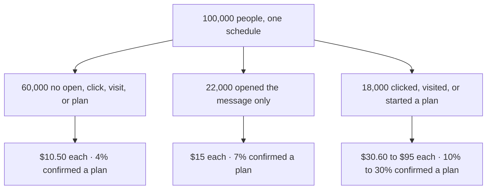

# Product vision

Adaptive Resolution is a personal agent in the thread the consumer already uses. They reply by SMS, or by iMessage where the handset and the permission allow it. The agent reads the intent and either takes the next conversational step or opens one authenticated task. The portal is that task. People should not have to find a second chat inside another website.

Composer already personalises an outbound email or SMS. It still sends on a fixed calendar: email on days 0, 7 and 21, SMS on days 3 and 14, each at 10:00 local time. A click does not change the next message. An unfinished plan does not either. The person who writes "I get paid next Friday" receives the same account link as the person who never looked. That schedule stays the control. The new behaviour starts when someone writes back.

A payday preference opens approved arrangements that might fit that pay cycle. An account question opens verified detail after a check, or goes to support. An interruption returns a saved draft when one exists. Hardship and disputes go to a person, and collection prompts pause. The agent remembers the preference on the next turn. It does not invent a date, enrol a plan, or take a payment. The consumer confirms. A plan earns nothing until cash settles.

Eight interviews with people who left a plan named the intents worth routing: a mismatched date in three, an interruption in two, an account question in two, and time to check household costs in one. Of 50 support conversations after a portal visit, 12 were about dates, nine about the account, and seven about resuming. That is a reason to test these routes. It is not a measure of how common each need is.

## The market the link misses

One synthetic intake, 100,000 people, all on that schedule. Cohorts are mutually exclusive. Each person is labelled by the deepest signal in the day before measurement, and the label never changes. Nobody in this file received a conversation.

**82,000 people never open the account link.** Sixty thousand show no engagement. Twenty-two thousand open the message and stop. They are 82% of the intake and $960,000 of the $1.78 million settled in 30 days. The 18,000 who click, sign in, or start a plan produce the other $820,000.

| Cohort | People | Paid by day 7 | Paid by day 30 | Plan by day 30 | Cash each |
| --- | ---: | ---: | ---: | ---: | ---: |
| No observed engagement | 60,000 | 3% | 7% | 4% | $10.50 |
| Opened the message, never the link | 22,000 | 5% | 10% | 7% | $15.00 |
| Clicked the link | 10,000 | 10% | 18% | 10% | $30.60 |
| Visited, no plan started | 6,000 | 20% | 30% | 15% | $54.00 |
| Started a plan, left it unfinished | 2,000 | 35% | 50% | 30% | $95.00 |

This is a description of the current journey, not a forecast. A clearer portal helps someone who returns. It cannot help someone who never opens the link. The first experiment stays with the 18,000, where interviews named a barrier. The 82,000 are the market the agent is built to earn, once a reply is safer than another unused link.

## The dials

Recovery means voluntary cash, and a confirmed plan when a plan is the right path to that cash.

| Dial | Baseline | What we are trying to move |
| --- | --- | --- |
| Reply rate | 60% never open; 22% open and still miss the link | A reply from people a scheduled link does not reach |
| Mean time to a confirmed plan | No day-of-enrolment in the file. By day 30, confirmation runs 4% → 7% → 10% → 15% → 30% | Fewer days from the first useful reply to an explicit enrolment |
| Mean time to settled cash | Paid by day 7 runs 3% → 35%; paid by day 30 runs 7% → 50% | Earlier settled cash when the barrier was timing or a missing answer |
| Cash per person | $10.50 → $15 → $30.60 → $54 → $95 | More settled cash per person assigned, including people who never reply |
| Safety | Opt-outs 0.6% to 1.5%; complaints 0.06% to 0.30%. Both rise with engagement | Speed that stays inside the opt-out, complaint, and support stop rules |

People closer to an action pay sooner and confirm a plan more often. The agent tries to shorten that distance by answering the stated need instead of waiting for the next calendar slot. Plan starts stay a diagnostic. The result that decides the investment is incremental settled cash per person randomised onto the agent, against this schedule, with non-responders kept in the count.

The learning cap and stop rules are in the [decision note](../DECISION.md). The [demo](../README.md) runs this loop on synthetic SMS. iMessage is the same loop in the native thread. The exercise only establishes email and SMS permission, so iMessage needs its own permission, disclosure, and provider path before anyone sends it.

Figures: [historical cohorts](../brief/03_historical_cohorts.csv) and the [supporting pack](../brief/02_supporting_pack.md). All of them are synthetic.
